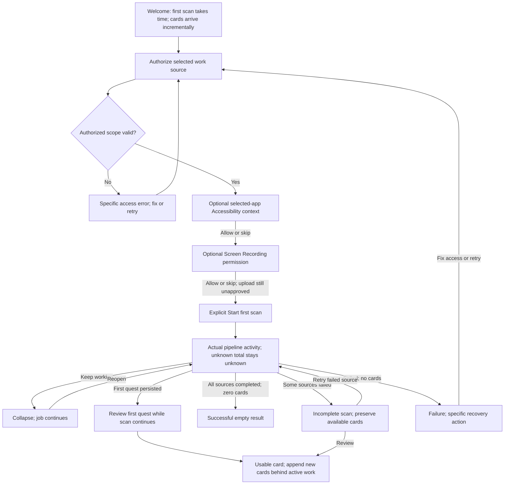
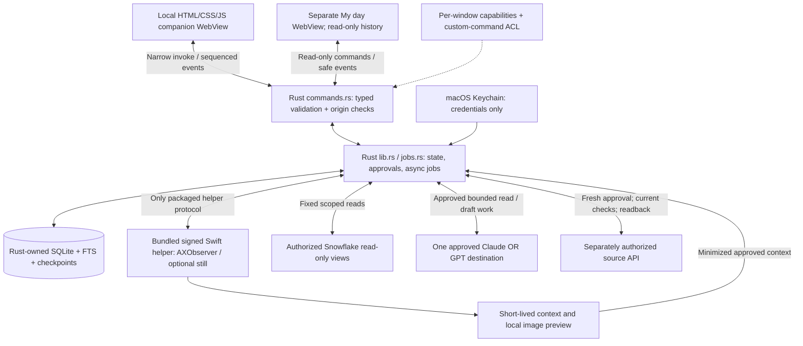

# Open Loops — product and implementation plan

**Status:** proposed native product; browser prototype revisions are in flight outside this repository. This checkpoint delivers documentation only. No native runtime, live integration, or new application scaffold is implemented here. Final browser source/evidence synchronization remains pending `FINAL-READY`.

[README](README.md) records the exact Git initialization output and external canonical source paths. This plan consolidates the agreed product contract; final source-plan snapshots will preserve detailed visual copy and provenance without treating old evidence as current proof.

## 1. Outcome, scope, and non-goals

### Product outcome

Make an office open loop easy to recognize, decide, and act on without opening a chat session. Read queryable, authorized Snowflake evidence; present one cited quest; offer numbered choices; obtain exact approval; prepare one bounded result with Claude **or** GPT. Keep agent work and real source changes distinct.

The narrow first workflow is a stale request such as `REQ-184`: inspect related request evidence, propose a duplicate-closure recommendation or a question for Maya, and prepare the chosen result. A recommendation does not close a request. A draft does not send a message.

### Settled implementation decisions

| Area             | Decision                                                                                                                                  |
| ---------------- | ----------------------------------------------------------------------------------------------------------------------------------------- |
| Desktop runtime  | Tauri v2, macOS, local HTML/CSS/JS renderer in the system WebView; **no Electron**                                                        |
| Privileged owner | Rust owns commands, state, background jobs, network calls, credentials access, persistence, and approval enforcement                      |
| Optional context | Bundled/signed Swift AXObserver helper; optional ScreenCaptureKit still capture of a user-selected allowed window                         |
| Durable memory   | One local SQLite database, FTS for source-cited summaries, deterministic job/quest/snooze/acceptance records; no vector DB                |
| Product surfaces | Floating companion for decisions; separate optional My day dashboard for personal observability; shared local store, no telemetry service |

### Deliberately excluded

No chat-first interface, fake desktop scene, autonomous sending/closing, broad desktop surveillance, keystroke logging, raw-video upload, multi-provider orchestration framework, separate queue/backend/event service, speculative plugin architecture, or placeholder native scaffold. Do not implement both providers before one complete, approved read/draft path works. No auto-opening the companion or auto-accepting quests.

## 2. Companion, cards, and user decisions

### Physical and navigation contract

- A floating buddy opens a compact ceramic/moss container with an unmistakable **physical swipe card**, lift shadow, and truthful backing-card edges. Backings reflect real remaining cards and are inert. No borderless form masquerading as a card; no nested card within the quest.
- Default shell is 390 × 520 CSS px; header is a stable 132px with navigation above the buddy/XP row. Use one buddy, not both a detached and docked copy. Companion remains optically prominent.
- **Back is fixed top-left in every secondary view; Close is fixed top-right.** Root reserves Back's slot. Back pops one view and preserves the quest, draft, and job. Close hides, not cancels. Escape performs Back when available, otherwise Close. Neither action approves work.
- On 390/320px viewports use `min(390px, calc(100vw - 24px))`; scroll long body/brief content without hiding essential actions or shifting header controls. Preserve usable type at 200% zoom, selectable evidence, 44px icon targets, and no horizontal overflow.
- Review architecture, fixture controls, and reset live outside the product surface. Browser preview has a persistent `Preview` marker and accurate consequential receipts. Native transparency/click-through placement requires separate packaged-app verification.

The precise color/type/spacing values, optical sprite positions, copy, and gesture physics remain in the final `redesign-direction.md` snapshot. The agreed palette uses ceramic shell `#F0F2EC`, card `#FFFEFA`, ink `#27332D`, and moss `#355F50`; use native system type, rem-based text/spacing, and plain numbered choice rows rather than decorative tiles.

### Decision flow

```mermaid
flowchart LR
  Card["Cited quest card"] -->|Left swipe or Later| Snooze["Choose one of three return times"]
  Snooze --> Saved["Persist snooze; no XP; no agent"]
  Card -->|Right swipe or Next step| Choices["Two or three numbered scoped tasks"]
  Choices --> Brief["Exact brief, evidence, provider, limits"]
  Brief -->|Edit| Brief
  Brief -->|Explicit Accept quest| Accept["Atomic acceptance; +10 XP once"]
  Accept --> Job["Bounded read and draft job"]
  Job --> Result["Prepared result; source unchanged"]
  Result -->|Separate review| Approval["Exact source operation and payload"]
  Approval -->|Fresh explicit approval| Check["Recheck actor, source version, evidence"]
  Check --> Write["Authorized write and authoritative readback"]
  Write --> Receipt["Confirmed or unverified outcome"]
```



### Quest fixtures and scoped options

| Quest       | Cited situation                                                     | Numbered next actions                                                                                                          |
| ----------- | ------------------------------------------------------------------- | ------------------------------------------------------------------------------------------------------------------------------ |
| `REQ-184`   | Laptop arrived; request still open; possible duplicate of `REQ-221` | 1. Check the duplicate evidence. 2. Draft a closure recommendation, close nothing. 3. Draft a question for Maya, send nothing. |
| `APR-42`    | Launch brief needs the person's review                              | 1. Summarize approval context. 2. Draft a revision request. No approval on the person's behalf.                                |
| `Thread 17` | Leo is waiting for a timeline; saved thread has no later reply      | 1. Draft a reply without unverified dates. 2. Check the saved thread for the promise and missing context.                      |

Left presents `In 1 hour`, `Tomorrow morning`, and `Next week`, including the actual return date/time and timezone in the native product. Browser fixture timestamps are explicitly fixed sample times, not the viewer's current clock. A fixture snooze says no real reminder was scheduled. Undo affects the snooze, not acceptance or source state.

Before acceptance, show the chosen provider/destination, read scope, intended output, hard restrictions, and full editable outgoing brief. Editing must not expand hard limits. Changing task, scope, destination, or payload invalidates prior confirmation. In the current browser concept, show `Demo agent`, not a fake live provider picker, and state that no request leaves the browser.

### Input, sound, and idle behavior

- Use Pointer Events with native vertical scrolling. Ignore controls/text-selection regions; lock horizontal intent only after a deliberate horizontal drag; cancel or lost capture returns the card. A committed swipe opens a chooser only. Suppress synthetic click and duplicate gesture handling.
- Keep explicit Later/Next step buttons and keyboard equivalents. Arrow shortcuts act only on the focused quest region, never while editing. Restore focus on Back/Close; announce important state changes once, not every activity event.
- Reduced motion removes travel/rotation/animated progress. No perpetual bobbing, flashing, or forced timed dismissal of essential content.
- Optional synthesized sound is gesture-unlocked, short, quiet, and independently mutable. Mute is always discoverable; unavailable audio must not block work. No sounds for idle, hover, event-stream rows, or background discovery.
- At approximately **300 seconds of OS idle**, refresh eligible evidence and suggest a due quest quietly through the buddy. No automatic popup, focus movement, acceptance, source action, or noisy notification. Pause/disable this behavior by preference. Browser timer simulation is not proof of native OS idle detection.

### Acceptance, XP, and evolution

**+10 XP on explicit acceptance, exactly once per quest ID, not on completion.** Zero XP for swipes, task selection, snooze, evidence inspection, setup, scan progress/completion, or source writes. Failure/cancellation after acceptance keeps XP; cancellation before acceptance awards none. Retrying or accepting the same quest again cannot farm XP.

Pip: 0–19 XP. Scout: 20–29 XP. Guide: 30+ XP. Derive stage and progress from authoritative unique acceptance records; no independent contradictory level counter. Show threshold celebrations once, retain accessible text, respect mute/reduced motion, and stop the progress rail at Guide rather than implying another level. XP is an engagement mechanic, **not business proof**.

## 3. First installation and first scan

### Native onboarding tree — proposed, not implemented

The same companion shell hosts setup; no separate wizard application. Source authorization comes first. Optional Accessibility access and optional screen capture are independent, skippable choices. Granting either is not permission to upload context or send/write anything.



### Browser demonstration — deliberately different

Start with `Start setup preview` and `Skip to ready preview`. Skip reveals the three fixture cards at zero XP, without inventing a completed scan. Do not collect actual credentials or pretend browser controls grant macOS permissions.

`Start setup preview` shows **Simulated activity · no workspace connected**. Illustrative deterministic schedule: 0s sample scan started; 1s sample `REQ-184` reviewed; 2s first sample quest ready; 3.5s sample `APR-42` reviewed; 5s sample `Thread 17` reviewed; 6s sample scan complete. These are script timings, not live pipeline events, product performance measurements, or promises.

The first card becomes usable at the 2s sample event; later events continue behind it. Demo controls for successful-empty, failure, and partial failure remain outside the main companion. Current implementation and exact checks await the final verified source snapshot.

### Runtime states and activity truth

| State                       | What the person sees                                  | Required behavior                                                                |
| --------------------------- | ----------------------------------------------------- | -------------------------------------------------------------------------------- |
| Processing, zero cards      | Looking for your first quest; latest actual events    | Keep working hides UI without stopping job. Never say no quests found yet.       |
| Processing, cards available | First quest ready; `N ready · Scan running`           | Review immediately; append behind active card; do not move focus or reset draft. |
| Completed, zero cards       | No quests found in successfully checked sources       | Only after all selected sources completed successfully.                          |
| Partial                     | `N quests ready. Scan incomplete.` plus source/reason | Preserve cards and checkpoint; retry failed source without duplication.          |
| Failed, zero cards          | The scan could not finish; observed reason            | Fix permission/auth or retry; never claim workspace is clear.                    |

Use source connection, batch loaded, analyzing batch, quest created, completed, and failed events only when those transitions occur. Show timestamps, source names, and observed cumulative counts. No fabricated percentages, stages, ETA, or rolling counter animation. Waiting is `Waiting for [source]`, not an invented work event.

Show the latest three activity rows in the companion with access to longer history. Announce the first available card and final result politely; do not flood assistive technology. The collapsed buddy has a static processing marker and/or ready count, never auto-opens, and restores current scan/card state on reopen. If every currently available card is reviewed while scanning continues, show `Looking for more quests`, not a successful-empty result. If a job remains running, an empty deck does not mean all work is done.

## 4. Target architecture and trust boundaries

All paths in this section are **proposed future implementation files**, not files already scaffolded in this repository.



### Privileged boundary

Tauri custom application commands are **not restricted merely by registering them**. Declare their permissions through `src-tauri/build.rs` with `AppManifest::commands`, include only necessary command permissions in per-window capability files, and validate every privileged request again in Rust. Verify this wiring against the pinned Tauri v2 API/version during implementation. UI affordances and disabled buttons are not authorization.

Only bundled local assets may invoke these capabilities. Use a restrictive CSP and explicit external-navigation policy; render source/model content as untrusted text, not executable HTML. Do not grant broad filesystem, shell, HTTP, SQL, or opener capability to the renderer. Avoid remote scripts/fonts in the packaged production renderer even if the browser prototype uses review-time CDNs.

Rust checks window identity/origin, authorized actor, object ownership, allowed operation, field lengths/types/enums, payload size, selected source scope, permission state, and current approval. Reject unknown commands and unexpected fields. The renderer never supplies arbitrary SQL, shell commands, executable paths, provider URLs, Keychain queries, or unrestricted filesystem paths.

### Proposed command surface

| Commands                                                                                  | Allowed intent and validation                                                                                                                                             |
| ----------------------------------------------------------------------------------------- | ------------------------------------------------------------------------------------------------------------------------------------------------------------------------- |
| `get_snapshot`, `get_events_since`, `get_activity`, `search_memory`                       | Bounded, redacted queries; enforce actor/window scope, cursor/sequence validity, result limits. My day gets only these read capabilities.                                 |
| `start_bootstrap`, `retry_source`, `cancel_job`, `snooze_quest`                           | Host-generated stable IDs; authorized source subset; bounded timestamps; cancellation owns no source rollback; duplicate request IDs reuse results.                       |
| `prepare_brief`, `accept_quest`                                                           | Resolve evidence and hard limits in Rust; immutable brief revision/hash plus selected destination; acceptance/job/XP transaction; edited brief requires new confirmation. |
| `set_context_preferences`, `request_capture`, `approve_context_upload`, `discard_capture` | Allowlisted app/window, separate permissions, bounded still capture; exact content hash and approved destination; no caller-defined capture path.                         |
| `prepare_source_action`, `approve_source_action`                                          | Exact record, recipient/target, operation, payload hash, expected source revision, fresh approval; recheck permissions/evidence immediately before write.                 |

Names are proposed API names, not claims of implemented commands. Split capability grants by companion versus My day; validate reads as well as writes. Approval must be bound to one specific intent and expire or invalidate on material change. Never log tokens, full sensitive payloads, or raw context in diagnostics.

### Async bootstrap, snapshots, and recovery

```mermaid
sequenceDiagram
  participant UI as WebView
  participant R as Rust owner
  participant DB as SQLite
  participant SF as Snowflake
  UI->>R: Subscribe to allowed events
  UI->>R: Request snapshot and cursor
  R->>DB: Read consistent jobs, quests, last sequence
  R-->>UI: Snapshot at sequence N
  UI->>R: Replay after N; buffer / deduplicate live events
  UI->>R: Start or resume bootstrap with request ID
  R->>DB: Persist job and source checkpoint
  R->>SF: Authorized bounded batch
  SF-->>R: Actual records and cursor
  R->>DB: Transaction: upsert quest, checkpoint, ordered event
  R-->>UI: quest_created with job_id and sequence
  Note over UI,R: Card usable before full scan; closing WebView does not stop Rust
  R->>DB: Persist completed / partial / failed result
  R-->>UI: Terminal event or replayable status
```

Run I/O through Rust's async runtime and isolate blocking SQLite/native work from the UI thread. Keep one simple job owner, not a new queue service. Every durable event carries `event_id`, `job_id`, monotonic persisted sequence, timestamp, source where applicable, kind, and bounded truthful payload. Persist state/checkpoint/event in one transaction **before emitting**. Query the journal rather than relying on transient Tauri event delivery as durable truth.

Register listeners before requesting a snapshot or starting work. Buffer incoming events while reconciling; discard sequences already included in the snapshot, apply later events in order, and request replay/snapshot on gaps. Persist source cursor, completed batches, failures, stable quest identity, and job status. Reopen uses the same job, not an implicit new scan. Restart resumes a safe checkpoint with idempotent upserts; no work runs while the app process is stopped. A fresh scan versus retry must be explicit, with deterministic quest identity across repeated evidence.

Keep bounded retry/backoff and actionable error reasons. Cancellation stops future work where possible but does not roll back a completed external request. After a network timeout with unknown outcome, reconcile; never blindly repeat a possibly executed write.

## 5. Local memory, credentials, and context

### Data ownership

| Data                                                 | Owner / persistence                                                     | Invariants                                                                                                                                |
| ---------------------------------------------------- | ----------------------------------------------------------------------- | ----------------------------------------------------------------------------------------------------------------------------------------- |
| Quests, evidence refs, snoozes, acceptance           | Rust / SQLite                                                           | Stable quest ID tied to source identity; explicit source and observed time; one unique acceptance per quest. Snooze does not mean closed. |
| Jobs, checkpoints, events, approvals, source actions | Rust / SQLite                                                           | Transactional progress and sequence; approvals bind exact revisions/hashes; external outcome may remain unknown.                          |
| Useful summaries and activity                        | Rust / SQLite + FTS                                                     | Cited evidence, observed/inferred label, origin, timestamp, retention/expiry. Do not treat a summary as fresher than its source.          |
| Access credentials                                   | Rust/native / macOS Keychain                                            | No secrets in SQLite, HTML, browser storage, repository, events, or logs. Keychain does not encrypt SQLite automatically.                 |
| Working context and raw stills                       | Rust/native / short-lived RAM or necessary tightly bounded temp storage | Discard by default after use/cancel/expiry; no retained screenshot history without explicit choice.                                       |

Proposed minimal schema in `store.rs`: `quests`, `evidence_refs`, `snoozes`, `acceptances` with `UNIQUE(quest_id)`, `jobs`, per-source `job_checkpoints`, ordered `job_events`, revision-bound `approvals`, `source_actions`, `memory_summaries` plus FTS, and timestamped `activity_events`. Keep activity/evidence references shared rather than copying full raw content into a second analytics store. Store schema version/migrations only when persistence is implemented.

Acceptance inserts the unique acceptance, queues the approved job, and records the event in one transaction. A failed duplicate insert cannot increment XP or dispatch a second equivalent job. If a new user-approved retry job is allowed, it links the same acceptance and earns no further XP. Do not fabricate exactly-once network guarantees from a local uniqueness constraint.

Use FTS with IDs, person/source filters, and recency for retrieval. Retain short cited summaries, not every raw AX event. Superseded or stale memory can suggest a query but cannot authorize a write. Retention duration, delete/export behavior, local file permissions, and any at-rest encryption requirement are release decisions; do not assume Keychain covers them.

### Optional native context

`native/ContextObserver.swift` uses AXObserver/AXUIElement against an explicitly allowed app. Register for supported change/focus notifications, debounce, compute bounded deltas, and report structured records with timestamps and provenance. AX coverage is incomplete: unsupported web/canvas controls and inaccessible content stay **unknown**, not guessed. Do not log keystrokes or scrape every app. Idle uses an OS idle signal, not saved keyboard input.

Rust launches only the packaged helper; the renderer cannot choose an executable or shell arguments. Validate helper JSON-line messages for length, shape, allowlisted app identity, and expected fields; restart/permission denial must fail safely. One helper is sufficient; no native helper farm.

A screenshot requires a user-selected window, separate screen permission, a one-shot ScreenCaptureKit still, local preview/masking, and approval of the exact bytes and destination before upload. Approval of Accessibility access is not screen permission; screen permission is not upload permission. If masking changes the image or destination changes, reapprove. Clear revoked/expired captures. No continuous recording or silent raw-video upload.

## 6. Model jobs and source-write safety

Choose one approved provider/model for the first live path. Rust holds its credentials, host allowlist, request budget, timeouts, tool allowlist, and output bounds. Send only the exact approved evidence/context, not the entire desktop or memory store. Record which evidence IDs and optional capture hash were used so the result has provenance without retaining raw screenshots.

The model may request only bounded read tools and return drafts/findings. Rust constructs parameterized Snowflake reads against approved views and enforces actor/row scope; model-generated SQL, arbitrary URLs, shell, and direct source writes are forbidden. Treat source records, AX text, screenshots, and model text as data that may contain prompt injection. Their embedded instructions cannot expand granted scope.

Before a source operation, show full payload, record/recipient, action, and consequences in a separate confirmation. Re-fetch authoritative current state and actor permission; stale Snowflake snapshots alone cannot validate a write. Reject denied access, changed revision/status, missing evidence, or changed payload. Use an idempotency/action ID where the source supports it, then read back from the authority.

| Outcome                                             | UI / persistence rule                                                                          |
| --------------------------------------------------- | ---------------------------------------------------------------------------------------------- |
| Prepared draft or recommendation                    | Source unchanged; never announce sent, approved, or closed.                                    |
| Confirmed matching readback                         | Record source-confirmed outcome and timestamp. Count an eligible distinct closure once.        |
| Permission denied / stale source / missing evidence | Preserve draft; explain recovery; require a fresh review after changes.                        |
| Timeout or ambiguous response                       | Outcome unverified; reconcile by action ID/source state before retry. Never say safely failed. |
| Browser simulated receipt                           | Fixture result only, source unchanged; never enters real business metrics.                     |

## 7. Personal observability — separate My day surface

My day is an optional read-oriented dashboard, not a second decision interface or surveillance feature. Its browser mockup is pending; its live data ownership is proposed Rust + the **same SQLite database**. No remote telemetry collector, analytics backend, OpenTelemetry deployment, or second event database is required.

Show a chronological activity timeline, accepted quests versus source-confirmed outcomes, agent jobs and recoverable failures, and memory with source provenance. Each item distinguishes **observed**, **inferred**, and **demo**. Label missing coverage; do not equate lack of AX events with inactivity or infer productivity from elapsed app time. User review/deletion and retention remain explicit policy gates. My day's WebView cannot initiate privileged capture, approve jobs, or write sources through its read capability.

### Measurement definitions

| Metric                                               | Definition and exclusion                                                                                                                                                                                                                                                               |
| ---------------------------------------------------- | -------------------------------------------------------------------------------------------------------------------------------------------------------------------------------------------------------------------------------------------------------------------------------------- |
| Decision time                                        | Elapsed time from recorded `question_submitted` to the person's explicit `decision_confirmed`, linked by question ID. Exclude unrelated scan/job completion timestamps. Show sample count and unresolved questions; do not invent a pre-question start time.                           |
| Distinct stale loops source-verified closed per week | Count distinct source+record identities with matching authoritative closure readback during the chosen week that were stale **more than 30 days** under the agreed source-age definition. Exclude suggestions, XP, drafts, demo records, duplicate readbacks, and unverified outcomes. |
| Acceptance / XP                                      | Unique explicit acceptances and derived companion stage. Display separately from confirmed business outcomes.                                                                                                                                                                          |
| Job health and provenance                            | Status, duration where measured, cancellation/error reason, approved provider, evidence refs, and result links. No secrets or raw captured content.                                                                                                                                    |

Before release, agree the source field defining staleness (created versus last meaningful activity), reporting timezone/week boundary, reopened-record treatment, and decision-time aggregation. A reasonable proposed default is age since last meaningful source activity immediately before confirmed closure, each source+record counted once in a reporting week; label it as provisional until agreed. Missing authoritative history means unknown eligibility, not a counted closure.

## 8. Implementation order and four-hour vertical slice

### Prerequisites — check before starting the estimate

The estimate assumes a macOS development machine with working Xcode/Command Line Tools, Rust and Tauri v2 toolchain, plus access to the final approved browser source. Confirm exact versions and minimum supported macOS rather than assuming this machine proves distribution support.

For a **live** slice, obtain user-approved Snowflake account/warehouse/database/schema/views and actor/row scope; reachable network; one approved Claude or GPT model/API credential and data handling policy; and a representative safe read/draft scenario. Store credentials in Keychain. A source-write connector requires separate authorization and is not a prerequisite for read/draft acceptance.

For native context or distribution, also require an allowed target app, test consent for TCC prompts, a stable bundle ID, appropriate signing identities/entitlements, and selected architectures/minimum OS. Screenshot capture additionally needs its separate permission and confirmed ScreenCaptureKit API availability. Missing prerequisites become visible blocked gates, never fake live success.

### Proposed file/module sequence

| Order                             | Future files                                                                                                                                                                             | Responsibility / dependency                                                                                                                                                                                             |
| --------------------------------- | ---------------------------------------------------------------------------------------------------------------------------------------------------------------------------------------- | ----------------------------------------------------------------------------------------------------------------------------------------------------------------------------------------------------------------------- |
| 1. Host and boundary              | Final local `index.html` / existing JS-CSS structure; `src-tauri/Cargo.toml`, `tauri.conf.json`, `build.rs`, `capabilities/default.json`, `src/main.rs`, `src/lib.rs`, `src/commands.rs` | Reuse verified UI; minimal Tauri host; custom-command permissions, origin/argument validation, CSP, packaged local assets. Do not add a new frontend framework.                                                         |
| 2. State and bootstrap            | `src-tauri/src/store.rs`, `jobs.rs`; renderer bridge at existing state owner                                                                                                             | SQLite schema/FTS, unique acceptance, event journal/checkpoints, snapshot/replay, async startup/retry/cancel, card append without focus/draft reset.                                                                    |
| 3. One live evidence/draft path   | `src-tauri/src/snowflake.rs`, `provider.rs`; `commands.rs` / `jobs.rs`                                                                                                                   | Fixed scoped query, cited quest, selected numbered task, immutable approval revision, bounded one-provider read/draft, truthful result/error. Split files only for actual ownership, not a generic connector framework. |
| 4. Optional authorized extensions | `src-tauri/src/context.rs`, `native/ContextObserver.swift`; later `src-tauri/src/source_actions.rs`                                                                                      | Normalize AX/native messages; separately gated still capture. Implement source connector only with actual authorization and authoritative readback.                                                                     |
| 5. History, checks, packaging     | Existing My day HTML + narrow bridge; focused Rust checks and browser workflow check; Tauri bundling configuration                                                                       | Same-store read model, metrics/provenance, recovery checks, bundle helper/resources, sign/notarize and validate installed app behavior.                                                                                 |

These are planning names. No empty module, mock connector, TODO implementation, or generated scaffold is delivered in this documentation task. Follow actual final source organization rather than splitting one HTML into speculative modules merely to match this table.

### Four hours = 240 minutes, conditional development slice

| Time        | Bounded work                                                                                      | Exit evidence                                                                                                                           |
| ----------- | ------------------------------------------------------------------------------------------------- | --------------------------------------------------------------------------------------------------------------------------------------- |
| 0–30 min    | Host verified browser surface in Tauri; wire one narrow command and restrictive capability policy | Local WebView displays; allowed command works; unknown command/window/invalid payload denied.                                           |
| 30–85 min   | Implement store + job owner, scan events, snapshots/checkpoints, unique acceptance                | First card before scan completes; close/reopen and duplicate acceptance preserve state/XP; failures do not erase cards.                 |
| 85–150 min  | One real authorized Snowflake read and one chosen provider's bounded read/draft result            | Cited quest, exact brief approval, real result marked prepared only; missing credentials/access shows blocked, not simulated live work. |
| 150–195 min | Complete companion lifecycle and minimal same-store My day history/provenance                     | Back/Close/focus/draft stable; acceptance vs source outcome distinct; actual job events visible.                                        |
| 195–240 min | Run focused behavioral/security checks and development package smoke                              | Record exact versions, exercised files, failures, and one end-to-end read/accept/draft path. No release claim from a dev build.         |

This timebox is a coherent **development read/draft vertical slice**, not a promise of production-ready native sensing, two providers, source writes, or notarized distribution in four hours. If access/toolchain gates fail, finish the honest local slice with explicit unavailable integrations and report the blocker. Do not call a fixture run live.

### Later gated work — still part of the plan

Native AX, selected-window capture, real source writes, and distribution need their own implementation and acceptance after the narrow path. Budget a separate integration session for each, not hidden time inside the four-hour estimate. Actual duration depends on TCC behavior, source API support, signing/notarization access, and target application AX coverage. Keep each unavailable capability visibly absent rather than adding fake controls.

## 9. Validation and check scenarios

This is a **future acceptance matrix**, not a claim these checks have run. Historical 61-check evidence covers a superseded browser revision. Final browser verification must name exact files/screenshots and distinguish automated checks, visual review, and untested native behavior.

### Companion and accessibility

1. Inspect actual rendered closed/open, snooze, choices, evidence, edited brief, acceptance/running/result, source-action review, and 20/30-XP states at desktop and 390/320px widths. The open surface must read buddy + physical card + two actions, not fake desktop chrome.
2. Assert identical Back/Close header slots across all secondary views, including onboarding/activity. Test Escape, outside close, reopening, canceled drag, fast double input, touch vertical scroll, horizontal swipe, selectable text, and focus return.
3. Accept only through the explicit button; verify +10 once for unique quest ID, no XP for swipe/snooze, no additional XP on retry, and XP retained after post-accept cancellation. Check Pip/Scout/Guide derived thresholds.
4. Check 200% zoom, long briefs, 44px targets, keyboard without pointer, reduced motion, muted/unavailable audio, and no hidden essential action. Review active states visually, not just source declarations.
5. Verify quiet idle does not open, focus, play sound, or dispatch; browser virtual timer evidence is labeled simulation. Native OS idle behavior requires a packaged/runtime check.

### Bootstrap, persistence, and command boundary

1. Delay a real source; first quest arrives before complete. Exercise zero-card processing, successful-empty, partial failure, and full failure without contradictory all-clear copy.
2. While editing or confirming, emit new quests/events; active draft, card, focus, and selection remain. Close/reopen, disconnect/reconnect listener, inject duplicate/out-of-order event delivery, and verify ordered replay from durable state.
3. Restart between checkpoint and emit; resume safely without duplicate quests, acceptance, or source effects. Repeat start/retry request IDs. If DB transaction fails, do not emit fictional durable success.
4. Deny unknown window/origin/command, malformed or oversized arguments, arbitrary SQL/path/URL, unauthorized source/actor, and source/model prompt injection. Verify no renderer shell, secrets, DB handles, or broad native access.
5. Validate cancellation, expired credentials, network timeout, provider failure, and rate limiting with specific recovery. Native app exit stops work; reopening does not imply a separate always-running service.

### Native context, source safety, and observability

1. Test Accessibility denied/revoked, unsupported AX content, app allowlist changes, helper crash/malformed messages, and TCC behavior with the signed installed identity. Unknown content stays unknown.
2. Test screen permission independently; cancellation, local preview/masking, exact-image/destination reapproval, discard/expiry, and zero background upload. Confirm no raw screenshot or secret remains in logs/SQLite/default retained files.
3. Revoke actor permission or alter source state/payload between review and execution. Block stale/missing/denied writes. Simulate accepted network request followed by timeout: reconciliation precedes retry; no false closure receipt.
4. Confirm source readback mismatch remains unverified. Deduplicate eligible stale closures by source identity and reporting week; exclude demo, acceptance, draft, and XP from business metrics.
5. Check My day observed/inferred/demo labels, missing coverage, memory citations/expiry, unresolved decision time, and read-only capability. It must not bypass the companion's approval boundary.

Use a small number of runnable behavior checks at real boundaries; a SQLite-backed check for transactional acceptance/checkpoints, browser interaction checks, and focused installed-app tests where native behavior exists. No broad mock-framework scaffold is required. Record only checks actually executed and their exact outcomes.

## 10. Packaging and release boundary

Package renderer assets locally through Tauri configuration. Bundle the Swift executable with `externalBin`/resources as appropriate, using the correct target-suffixed binary naming and architecture support; have Rust spawn only that verified packaged helper. Pin compatible Tauri/Rust dependencies and retain the application lockfile.

Select bundle identifier, minimum macOS, entitlements, hardened runtime, signing order for nested helper/app, and notarization credentials under the user's release policy. Validate the signed installed app, not just development binaries: helper launch, permissions attributed to the expected identity, denied/revoked permissions, upgrades, app relocation, and quarantine/notarization behavior. Transparent window, always-on-top preferences, click-through regions, and focus behavior need real macOS validation.

The user authorized private GitHub publication and preview continuous delivery after the final verified snapshot. This does not authorize native distribution, signing-identity changes, public hosting, or an automatic update system. A successful development smoke does not establish App Store eligibility, production privacy compliance, or cross-version compatibility.

## 11. Skills and preserved guidance

Installed current user-level skills from Crewship are `app-dashboard` and `code-clarity` under `/Users/xiao/.agents/skills/`, with existing Claude links. The existing different `process-safety` skill was preserved, not overwritten. The source report records pinned commit `9897a9c845f7a7cdb3ab2dbb685ec647aa8c10d6`, 18 file-integrity matches, and the adapter warning `PromptScript does not support global skill installation`; that warning is not a claim the verified user-level copies failed.

Apply app-dashboard/shared-basics for legible choices, one primary action, explicit confirmation, honest loading, relative units, and accessible feedback. The explicit physical-card requirement overrides generic advice to remove borders. Apply code-clarity for one authoritative lifecycle, derived XP, scoped ownership, and failure distinctions based on real recovery. Its Electron-specific reference is historical guidance only: translate trust-boundary principles to Tauri, **do not reinstate Electron**.

Ponytail: smallest complete working slice, native/standard facilities first, no speculative service or framework. Caveman governs chat brevity, not document readability. Archify/Lavish guidance informed the decision to use Mermaid; this deliverable does not generate another diagram runtime or edit the ongoing review surfaces. The complete 35-skill catalog is not duplicated into this plan.

## 12. Handoff, snapshot, and open decisions

### This checkpoint

README, this plan, and `.gitignore` were delivered in an isolated initialized repository before publication work began. Native paths above are proposed only. Final source copy remains gated on `FINAL-READY`. The user subsequently authorized private GitHub commits/pushes and path-aware CI/CD; [docs/CI.md](docs/CI.md) owns the source-path matrix, stable required gate, downloadable delivery bundle, and actual verification record. No live app credentials, model request, source write, capture, or permission grant is part of publication.

### Pending final sync

After `FINAL-READY`, inspect the exact supplied filenames and final source decisions, reconcile this plan, and copy the approved final source/sprite/plan/evidence set without overwriting unrelated user files. Keep the prototype truthfully labeled and do not inherit old 61-check status. Record source/destination/hash and exact verification coverage. Preserve detailed final visual/onboarding/architecture notes as provenance; identify superseded Electron or older layout statements if historical files are retained.

### Unresolved facts

| Fact                                                                                               | Gate it blocks                                                   |
| -------------------------------------------------------------------------------------------------- | ---------------------------------------------------------------- |
| Final browser/dashboard assets and latest verification filenames                                   | Final source snapshot and claims about latest implemented UX     |
| Snowflake account/views, approved actor/row scope, freshness guarantees                            | Real evidence pipeline and authorization checks                  |
| Chosen Claude or GPT model, credentials, budget/data policy                                        | Live bounded agent work and upload destination                   |
| Source API/connector, permission model, revision/idempotency/readback support                      | Any real send, approve, or close operation                       |
| App allowlist, retention/deletion rules, metric age/week definitions, macOS targets/signing policy | Context capture, meaningful business reporting, and distribution |

These are missing inputs, not permission to guess or claim unavailable capabilities.

### Primary technical references

- [Tauri architecture](https://v2.tauri.app/concept/architecture/)
- [Tauri capabilities](https://v2.tauri.app/security/capabilities/)
- [Tauri command permissions](https://v2.tauri.app/security/permissions/)
- [Tauri sidecar packaging](https://v2.tauri.app/develop/sidecar/)
- [Apple AXObserver](https://developer.apple.com/documentation/applicationservices/axobserver) and [ScreenCaptureKit](https://developer.apple.com/documentation/screencapturekit)

References describe proposed integration choices, not proof that this repository already implements them.
