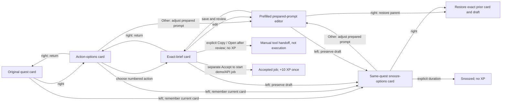

# Open Loops — delivery plan

**Current boundary:** browser prototypes and documented plans. The native Tauri application, Snowflake/model connections, SQLite/Keychain integration, native sensing, and source writes are not implemented. The previews and CI are published in [draft PR #1](https://github.com/i098/open-loops/pull/1), not merged. Repository visibility now reads public after an unexpected external change; this workstream preserved it.

## Read the plan

| Document                                                | Responsibility                                                                                                                 |
| ------------------------------------------------------- | ------------------------------------------------------------------------------------------------------------------------------ |
| [Architecture](docs/architecture.md)                    | Canonical Mermaid architecture, async runtime, integration gates, and native onboarding tree                                   |
| [UI design](docs/ui-design.md)                          | Physical-card silhouette, fixed navigation, precise copy/gestures, and first-run states                                        |
| [Implementation reference](docs/implementation-plan.md) | Complete data model/ownership, command boundaries, privacy, provider/source safety, file-level sequence, checks, and packaging |
| [CI and publication](docs/CI.md)                        | Actual tooling, path matrix, stable `PR gate`, Sentrux findings, GitHub publication and downloadable artifacts                 |
| [README](README.md)                                     | Delivered status, preview entry points, initialization receipt, and remaining prerequisites                                    |

Source hashes and transformations belong in [snapshot.json](docs/verification/snapshot.json); exercised checks belong in [local checks](docs/verification/local-checks.md). These receipts must match the final imported revision. This overview makes no current-pass claim; the old 61-check report is not current proof.

## 1. Product contract

Turn a cited office loose end into a prepared prompt, one numbered decision, and an explicitly approved handoff. The prompt can be copied and opened in Claude, Codex, or another fixed supported tool. An API agent runner remains optional. Prepared or copied text never implies execution, a sent message, closed request, or granted external-tool permission.

- **Companion:** an independent buddy, info card, and **5:7 poker-ratio** decision deck with meaningful backing edges, no heavy header, fake desktop, or shadows. The buddy keeps its stored resting anchor for the browser session. Root actions remain circular red-X/green-check controls; on child cards the green control becomes Back. No navigation bar, Back button, or reserved navigation space appears inside any card. Close stays in the info card. Preserve focus, draft, card, and running job.
- **Left:** choose one of three snooze times. **Right:** choose one of two or three numbered read/draft actions, inspect the full brief, then explicitly accept. Swipes themselves grant no permission and no XP.
- **Acceptance:** +10 XP exactly once per quest ID, immediately on explicit acceptance, not completion. A slim XP bar sits at the independent info card's bottom. Pip 0–19, Scout 20–29, Guide 30+. Retries, duplicate clicks, snoozes, and source writes cannot farm XP. Sound is optional; reduced motion removes slide/hop animation.
- **Source mutation:** a separate approval of exact recipient/record/operation/payload; recheck current actor permission, source revision/status, and evidence; perform authorized write and authoritative readback. Timeouts remain unverified until reconciled.
- **Idle:** after approximately 300 seconds of OS idle, optionally suggest a due quest quietly. Never auto-open, steal focus, accept, upload, or dispatch.

The buddy is the placed anchor. An independent info card always sits below the displayed buddy and owns Preview, sound, Close, count/age, progress, and status. The separate 5:7 deck owns quests, options, prompt editing, swipes, and its own sizing, position, and motion. Both open with the buddy; deck navigation never moves the info card.

Distinguish the stored **resting anchor** from the temporary **display pose**. Near the bottom edge, top-to-bottom order is **deck including circular actions, buddy, info**. Lift the displayed buddy only enough to fit the info card below it; fit the deck independently above it. Never flip info above the buddy or reserve room for the whole deck below it. Close restores the resting anchor; opening and viewport clamping must not overwrite it. Dragging an open buddy moves its info card, not the deck.

Desktop cards are normally 320×448px, never below 260×364px when width allows. Narrow cards use `min(260px, viewport width − 24px)` at the same 5:7 ratio. Never shrink cards or essential 16px text to fit the buddy/info stack. Use the deck's own scrolling viewport for short screens so its full-size card and controls remain reachable without overlapping buddy/info.

### Same-card navigation

Every option/detail screen uses the same 5:7 card boundary. Navigation never accepts a quest, starts a job, or changes XP. Preserve each card's parent, current quest, and draft; entering snooze again must not create nested snooze history.

### Complete card packs and readable motion

Generate each quest with its 2–3 stable action options, exact briefs, hard read/draft limits, and evidence references. Include the **Other…** affordance and snooze policies before validating and atomically persisting the complete card pack. Only then emit `quest_ready`. The first card waits for its own options, not the rest of the scan.

Swipes render stored options immediately: no LLM/network request, loading state, or agent job. **Other… always edits the existing prepared prompt**, prefilled with current quest/option context and constrained read/draft scope. It preserves edits on Back and requires save/review before explicit Copy/Open handoff; handoff grants no XP and needs no demo acceptance. Only starting a demo/API job requires separate Accept and grants +10 XP once per quest. The three fixed snooze durations stay; there is no custom-date workflow. Typing, copying, opening a page, or navigating never implies agent execution.

Keep essential text at least 16px; remove redundant minor subtexts rather than hiding safety scope. Motion follows the selected free [Transitions.dev references](docs/motion.md): 180ms/8px child-back changes, 240ms/24px deck entry, restrained buddy hop, and immediate reduced-motion/keyboard state changes. Use browser-native CSS/Web Animations; retain source provenance and the custom snippet-license limits. No Pro recipe, motion library, or CI dependency is added.

### Prompt handoff

Clipboard handoff needs no model API credentials. Copy writes exactly the reviewed prompt; a failed clipboard write must not claim success. Open launches only a fixed allowlisted Claude or Codex page and requires manual paste. Do not put the prompt into an invented URL scheme/query, autosubmit, or silently send it. Show copied/opened states, never ran/completed.

The planned Tauri fast path may launch an installed Claude/Codex tool only through a supported, explicitly approved adapter with validated argument arrays—not arbitrary shell. External-tool permissions remain external: the Open Loops app sandbox does not control a pasted prompt or the destination tool. Neither copying nor opening guarantees a run or completion. A direct API runner is a separate optional integration with its own credential/data approval gates.

## 2. First run and recovery

The first scan takes time; explain that before starting. Authorize work data first; make selected-app Accessibility and screen permission separate optional steps. Permission to observe or capture is not permission to upload or act.

Stream **actual** connection/batch/quest/completion/failure events from the native pipeline. Browser events must say they are scripted. Show an honest indeterminate first-scan bar without invented percentage or ETA. Use the first card as soon as it exists; append later cards behind active work without resetting focus/draft.

Distinguish processing with zero cards, successful empty completion, partial failure with usable cards, and failure with no cards. Preserve checkpoints and deduplicate retries. Closing hides the companion; it does not cancel a Rust job. App exit does stop the process; restart resumes from durable state rather than inventing an always-running service.

## 3. Architecture decisions

**Tauri v2/macOS, not Electron.** Local HTML/CSS/JS runs in a system WebView. Rust owns state, async jobs, credentials access, network requests, command validation, approval enforcement, and SQLite. Declare custom-command permissions as well as per-window capabilities; never assume registering a command automatically restricts it. My day receives only read capabilities.

Use three separate bounded windows: a tiny transparent **buddy window**, an **info window**, and a **deck window**. Rust owns the resting anchor, displayed buddy pose, and independent deck bounds; info follows below the displayed buddy. Optional My day uses a fourth, normal window. Give each window only its required capabilities. Avoid a common info/deck popover, fullscreen transparent click-blocking overlay, extra event bus, or per-window stores. The browser remains one DOM canvas and does not prove native focus, click-through, multi-display coordinates, or window positioning.

Bundle/sign a Swift AXObserver helper for one allowed app, with optional ScreenCaptureKit still capture of a user-selected window. AX is incomplete; unsupported content stays unknown. Keep capture local for preview/masking, require exact-image/destination approval before upload, and discard raw screenshots by default. No continuous raw-video upload or keystroke log.

One SQLite database owns deterministic quests, snoozes, acceptance, jobs/checkpoints/events, approvals, source receipts, and source-cited summaries. Use SQLite FTS plus IDs/person/source/recency filters; no vector database or telemetry infrastructure. Credentials belong in macOS Keychain, not SQLite. Keychain does not itself encrypt the application database.

Rust persists state/checkpoint/event atomically before emitting sequenced Tauri events. Subscribe before snapshot, reconcile buffered events after snapshot cursor, deduplicate, and replay gaps. A transient event bus is not durable state.

## 4. Personal observability and metrics

My day is a separate optional dashboard over the same local store, not a second approval path. Show timeline, agent jobs, accepted versus source-confirmed outcomes, memory evidence, and **observed / inferred / demo** provenance. No attention score or inferred productivity from app switches.

Measure question submission to explicit confirmed decision. Count distinct source-verified stale closures in Monday–Sunday UTC reporting weeks only with matching authoritative readback; stale means **at least 30 days** under the agreed source-age definition. Exclude reopened records, demo records, proposals, XP, duplicate readbacks, and unknown outcomes from business proof. The exact authoritative source-age field and decision-time aggregation remain release prerequisites; the reporting week and reopened-record exclusion are settled.

## 5. Four-hour development slice

This is a conditional **240-minute prepare/approve/handoff vertical slice**, not a promise of production-native integrations in four hours.

| Time        | Future work                                                                                                | Observable exit                                                                           |
| ----------- | ---------------------------------------------------------------------------------------------------------- | ----------------------------------------------------------------------------------------- |
| 0–30 min    | Reuse final renderer in minimal Tauri host; narrow command and capability policy                           | Allowed command succeeds; unknown command/window/payload rejected                         |
| 30–85 min   | `store.rs` + `jobs.rs`: durable state, acceptance uniqueness, scan events/checkpoints                      | First card early; close/reopen/restart and retries preserve state without duplicate XP    |
| 85–150 min  | Validated prompt review, exact clipboard copy, fixed tool-page handoff or supported installed-tool adapter | Reviewed prompt preserved; no unsupported prefill or execution claim                      |
| 150–195 min | Complete companion lifecycle and same-store My day read surface                                            | External green Back/info Close, preserved draft/focus, truthful events/outcome provenance |
| 195–240 min | Focused security/behavior tests and development package smoke                                              | Record actual toolchain, files, outcomes, and unresolved gates                            |

**Before the clock:** working macOS/Xcode/Rust/Tauri toolchain, verified browser source, clipboard access, and a chosen fixed tool page or supported installed tool. Live office evidence separately requires approved Snowflake access. An optional API runner separately requires provider credentials and a data policy. Clipboard handoff itself requires no API credentials. Missing prerequisites remain explicit blockers, not simulated live success.

**Later separately gated slices:** AX/helper/TCC, optional screenshot flow, authorized source connector, retention/delete/export policy, and signed/notarized distribution. Do not quietly include these in the estimate or fabricate their completion.

The [implementation reference](docs/implementation-plan.md) records exact proposed files, command families, transactions, error/recovery classes, and acceptance scenarios. No empty native scaffold was created to make the plan look implemented.

## 6. GitHub, quality, and continuous delivery

Repository: [i098/open-loops](https://github.com/i098/open-loops), currently public. Documentation bootstrap commit: `dd4ff34`. [Draft PR #1](https://github.com/i098/open-loops/pull/1) remains unmerged. Current publication and visibility receipts belong in [CI.md](docs/CI.md).

Every PR and main push runs path detection plus a stable **`PR gate`**, even for docs-only changes. Relevant format/lint/browser/Sentrux checks must succeed. Truly irrelevant jobs may skip; relevant cancellation, missing output, or skipped work fails. Workflow/toolchain/policy changes trigger every applicable check. No secrets are exposed to fork PRs.

Real Sentrux 0.5.7 uses pinned binary/grammar hashes, telemetry opt-out, strict reviewed rules, and nonempty extracted application JS with coverage checks. HTML-only or empty scans can pass without analyzing the application, so they are explicitly rejected. Do not inflate limits or save a PR-head baseline to force green.

A successful main push creates an actual downloadable preview archive with a SHA-256 manifest. A successful PR may produce a review artifact when packaged inputs change. Neither means hosted deployment or native release. The exact path matrix, Action pins, commands, results, and GitHub run/artifact links belong in [CI.md](docs/CI.md).

**Protection is not configured by this workstream:** the historical HTTP 403 was an entitlement restriction while the repository was private. Visibility now reads public after an external change; protection was not retried. Do not claim the workflow gate is server-enforced branch protection.

## 7. Final handoff gates

1. Receive final owner-approved companion, architecture, UI, sprite, and evidence filenames. Dashboard-only readiness does not authorize claiming the full suite is current.
2. Copy only approved sources. Extract inline runtime JS/CSS into `previews/assets/`, preserve relative links, and record source/final hashes and every transformation. Do not modify `.lavish` originals.
3. Recheck the **transformed repository copy**: formatting, language lint, CI-policy tests, browser behavior, strict nonempty-source Sentrux, and downloadable archive. Link actual evidence; retire old reports.
4. Push the completed feature branch, open the PR, inspect real GitHub checks and artifact, and report protection entitlement honestly. Keep the PR unmerged for user review.

Installed `app-dashboard` and `code-clarity` guide legibility, accessible approvals, honest progress, single ownership, and derived XP. Their historical Electron reference does not override Tauri. Preserve the installed-skill provenance without duplicating the 35-skill catalog.
