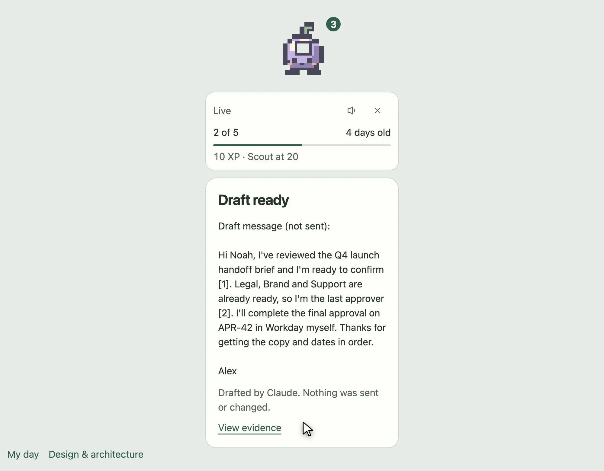
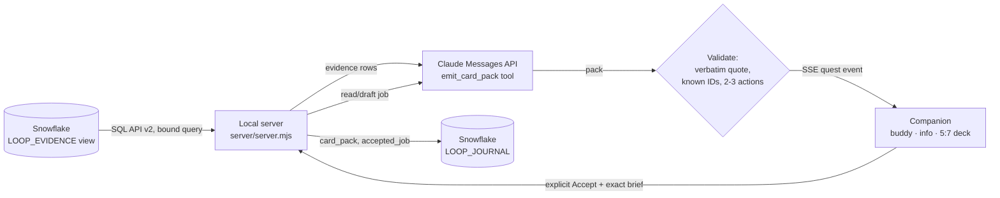

# Open Loops

A desk buddy that finds the work you forgot to close. It reads stale requests, pending approvals and unanswered threads from Snowflake, has Claude turn each one into a single decision card with a verbatim citation, and only runs a read/draft job after you explicitly accept it. Nothing gets sent, approved or closed on your behalf.

[](https://github.com/i098/open-loops/actions/workflows/quality.yml)
[](LICENSE)


https://github.com/i098/open-loops/raw/main/docs/media/open-loops-live.mp4

[](docs/media/open-loops-live.mp4)

_Recorded from the real flow against the hackathon Snowflake account: `npm run live` read 10 evidence rows from `OPEN_LOOPS.PUBLIC.LOOP_EVIDENCE` through the SQL API, Claude wrote the cards and the draft, and the run wrote `card_pack`, `snoozed` and `accepted_job` rows back to `LOOP_JOURNAL`. Recorded headless with [record-demo](demos/live-flow.mjs)._

Built at the [Intelligence at Work Hackathon](https://cerebralvalley.ai/e/intelligence-at-work-hackathon) (Snowflake + Anthropic, Menlo Park, Oct 23 2026). Submission write-up: [SUBMISSION.md](SUBMISSION.md).

## What it does

1. **Scan.** The server runs one fixed, parameter-bound query against a Snowflake view of open loops through the [Snowflake SQL API](https://docs.snowflake.com/en/developer-guide/sql-api/reference) (202 polling and result partitions handled). No model-written SQL.
2. **Card packs.** Each loop goes to Claude through the [Messages API](https://platform.claude.com/docs/en/api/messages/create) with a strict [tool schema](https://platform.claude.com/docs/en/agents-and-tools/tool-use/define-tools). The server rejects any pack whose quote is not a verbatim substring of a cited evidence row, or that cites an evidence ID it never sent. Cards stream to the companion over Server-Sent Events as each one validates, so the first card shows up before the scan ends.
3. **Decide.** Swipe left to snooze, right to see two or three prepared read/draft actions. Every action shows the exact outgoing brief, editable, before anything leaves.
4. **Accept.** Only an explicit Accept starts a Claude job (+10 XP once per quest). The result cites evidence inline as [1], [2]. It is a draft; the source record is unchanged.
5. **Remember.** With Snowflake connected, every generated card and accepted job is appended to `OPEN_LOOPS.PUBLIC.LOOP_JOURNAL` (VARIANT detail column), so the decision trail lives next to the data it came from.



Credentials stay in the server process. The page gets a label (`Snowflake OPEN_LOOPS.PUBLIC.LOOP_EVIDENCE` or `Demo data`) and the model name, never a token.

## Run it

Node 24+. No runtime dependencies beyond Node itself.

```sh
npm ci --ignore-scripts
export ANTHROPIC_API_KEY=...          # or see .env.example for Cortex AI Gateway
npm run live                           # http://127.0.0.1:4317/
```

Without Snowflake variables the server reads [data/demo-evidence.json](data/demo-evidence.json) and the UI says **Demo data**. To use Snowflake:

1. In a Snowsight worksheet, run [snowflake/setup.sql](snowflake/setup.sql). It creates the warehouse, `LOOP_EVIDENCE` (seeded with the same five loops), `LOOP_JOURNAL`, and a 7-day [programmatic access token](https://docs.snowflake.com/en/user-guide/programmatic-access-tokens).
2. Export `SNOWFLAKE_ACCOUNT` (org-account identifier) and `SNOWFLAKE_PAT`, then `npm run live`. The info card switches to **Snowflake**, and `GET /api/status` reports journal writes.

Every variable is listed in [.env.example](.env.example). Claude can also be reached through Snowflake's Cortex AI Gateway, which exposes an Anthropic-compatible Messages API with bearer-token auth: set `ANTHROPIC_BASE_URL` and `CORTEX_GATEWAY_PAT`.

The fixture-only browser preview still works with no server: `python3 -m http.server 4173 --directory previews`, then open `/open-loops.html`.

## Record the demo

```sh
npm run live &                         # needs a Claude credential
npm run demo:record                    # record-demo recipe: demos/live-flow.mjs
```

The recipe ends every beat on a `wait` for the real result (`.result-copy` after Accept), so a run where Claude fails publishes nothing.

## Develop and test

```sh
bun run format:check && bun run lint:code && bun run lint:docs
bun run test        # node:test: CI policy, import tooling, Snowflake + Claude contract tests
bun run test:ui     # Playwright: 9 interaction tests on the companion
bun run check:sentrux
```

[CI](docs/CI.md) runs these on every PR with a stable `PR gate` and uploads a preview bundle on main.

## Project layout

| Path                                       | What                                                                   |
| ------------------------------------------ | ---------------------------------------------------------------------- |
| [server/](server)                          | Live server: Snowflake SQL API client, Claude card packs and jobs, SSE |
| [previews/](previews)                      | Companion renderer (live when served by `server/`, fixtures otherwise) |
| [snowflake/setup.sql](snowflake/setup.sql) | One-shot Snowflake schema, seed data, journal table and PAT            |
| [data/](data)                              | Demo evidence, same rows as the Snowflake seed                         |
| [demos/](demos)                            | record-demo recipe for the README clip                                 |
| [docs/](docs)                              | Architecture, UI rules, motion, CI and the native Tauri plan           |

## Where it goes next

The browser companion is the hackathon slice. The [native plan](docs/implementation-plan.md) moves the same renderer into Tauri v2 on macOS (three small windows, Rust-owned state in SQLite, credentials in Keychain, Snowflake OAuth with PKCE) and adds authorized write-back as a separate, re-checked approval. See [architecture](docs/architecture.md), [UI design](docs/ui-design.md) and [PLAN.md](PLAN.md).

## Docs we leaned on

- Snowflake: [SQL API reference](https://docs.snowflake.com/en/developer-guide/sql-api/reference), [submitting requests and bind variables](https://docs.snowflake.com/en/developer-guide/sql-api/submitting-requests), [authenticating](https://docs.snowflake.com/en/developer-guide/sql-api/authenticating), [programmatic access tokens](https://docs.snowflake.com/en/user-guide/programmatic-access-tokens)
- Anthropic: [Messages API](https://platform.claude.com/docs/en/api/messages/create), [defining tools](https://platform.claude.com/docs/en/agents-and-tools/tool-use/define-tools), [streaming](https://platform.claude.com/docs/en/build-with-claude/streaming)
- Hackathon technical resource guide (Snowflake + Anthropic): Cortex Agents, Cortex AI Gateway, managed MCP server

## Contributing

[Contributing](CONTRIBUTING.md), [Support](SUPPORT.md), [Security](SECURITY.md), [Code of conduct](CODE_OF_CONDUCT.md), [Changelog](CHANGELOG.md), [Credits](CREDITS.md).

## License

[GPL-3.0-or-later](LICENSE).
