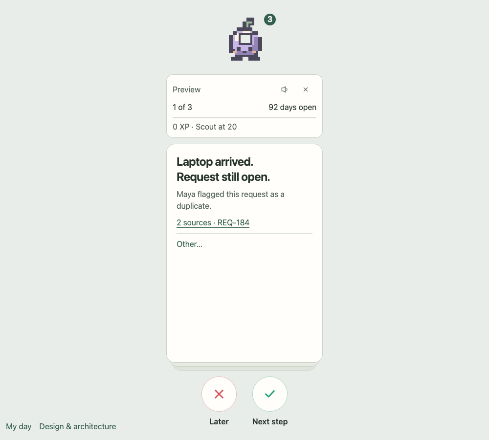

# Open Loops

A desktop-companion prototype for turning office loose ends into cited decisions and scoped agent work.

**Current status:** working browser previews and a native implementation plan. Scans, jobs, records and source receipts in the previews are synthetic. Tauri, Snowflake and Anthropic integrations are not implemented yet.

**License: TBD.** Public repository access is not an open-source license. See the [publication checklist](docs/OSS_READINESS.md) before assuming redistribution or contribution terms.



## Try the previews

From the repository root:

```sh
python3 -m http.server 4173 --directory previews
```

Open [the companion](http://127.0.0.1:4173/open-loops.html) or [My day](http://127.0.0.1:4173/personal-observability.html). Internet access is needed for the pinned preview style and diagram libraries.

The companion has a positionable buddy, independent info card and 5:7 decision deck. Swipes navigate; explicit acceptance earns XP once. Copy/Open exports a reviewed prompt for manual paste into Claude or Codex and never submits it automatically. My day shows example activity and evidence provenance.

## Develop

Use Node 24 or newer, Bun and Python 3. Install from the committed npm lockfile; use Bun to run local checks:

```sh
npm ci --ignore-scripts
bunx --no-install playwright install chromium
bun run format:check
bun run lint:code
bun run lint:docs
bun run test
bun run test:ui
bun run check:sentrux
bun run bundle
```

The browser suite has 9 interaction tests; 13 policy/import tests cover delivery tooling. Sentrux analyzes extracted application JavaScript with strict limits. [CI](docs/CI.md) uses Node 24 and uploads a preview bundle only after its gate passes. Bundles appear in successful [Actions runs](https://github.com/i098/open-loops/actions/workflows/quality.yml), not as a hosted app or native installer.

## Native plan

The target is Tauri v2 on macOS WKWebView, with Rust-owned state/jobs, SQLite and Keychain credentials. Snowflake SQL API supplies scoped evidence; Anthropic Messages API generates complete card packs and explicitly accepted read/draft results. Browser Chromium tests are not native-runtime proof.

| Document                                               | Scope                                                                                    |
| ------------------------------------------------------ | ---------------------------------------------------------------------------------------- |
| [Implementation contract](docs/implementation-plan.md) | File order, IPC, SQL schema/queries, Claude tool loop, stop gates and native acceptance  |
| [Architecture](docs/architecture.md)                   | Ownership, async runtime and onboarding diagrams                                         |
| [UI design](docs/ui-design.md)                         | Placement, cards, controls and interaction rules                                         |
| [Plan](PLAN.md)                                        | Product scope and development sequence                                                   |
| [Verification](docs/verification/local-checks.md)      | Executed checks, screenshots and [source/output hashes](docs/verification/snapshot.json) |

Live work still needs approved accounts, views, actor scope, an Anthropic API credential and model, and a data policy. Agent-host login tokens are not product API credentials. Source writes, native sensing and signed distribution require separate approval.

## Participate

Read [Contributing](CONTRIBUTING.md), [Support](SUPPORT.md), [Security](SECURITY.md) and the [Code of conduct](CODE_OF_CONDUCT.md). Changes are tracked in the [changelog](CHANGELOG.md); third-party references are in [Credits](CREDITS.md).

The [publication checklist](docs/OSS_READINESS.md) records unresolved licensing, private-reporting and maintainer decisions. No release, support SLA or native compatibility guarantee is published.
