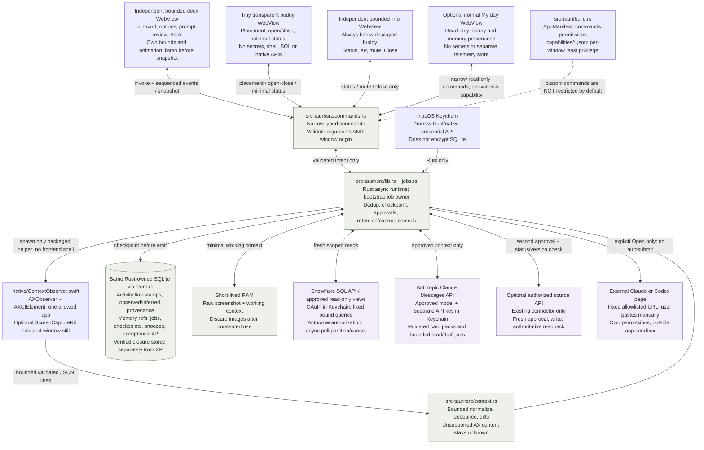
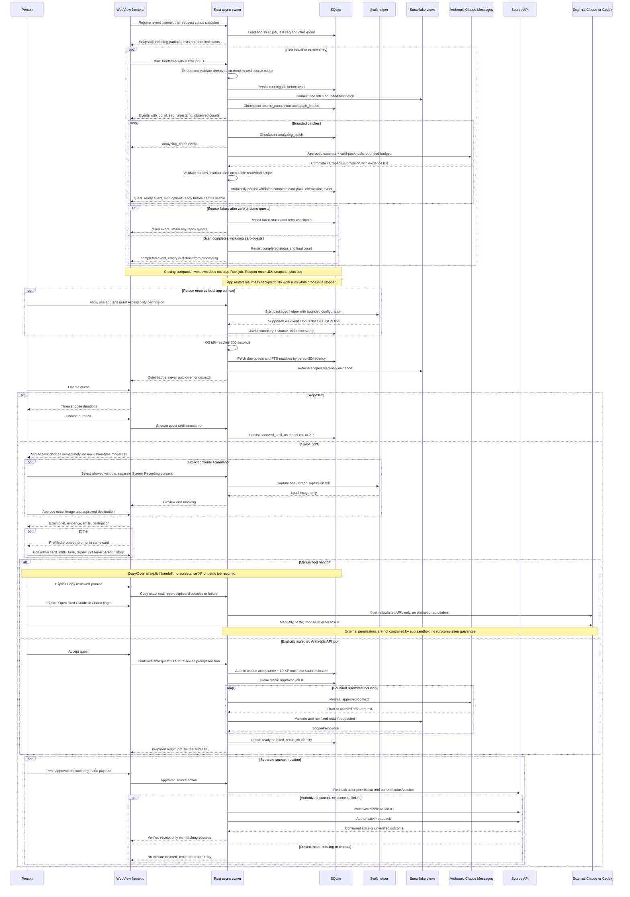
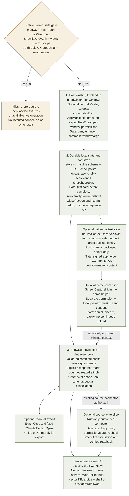
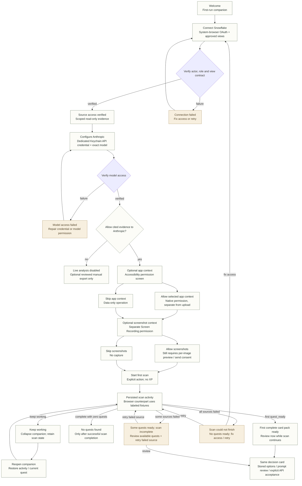

# Open Loops — proposed Tauri execution architecture

**Proposal only:** the HTML is a simulation; no native access, sync, database, model call, or source write is implemented. The selected native integration is **Snowflake SQL API + Anthropic Claude Messages API**, both called only by Rust. External Claude/Codex manual handoff remains an optional export.

On macOS, Tauri v2 renders in the system **WKWebView**, not Chromium. Chromium tests the browser preview only; native acceptance must run in the packaged Tauri app. Separate buddy, info, and deck windows share Rust-owned state, with optional normal My day. Deliberate drops replace the resting anchor; automatic boundary fitting does not; open drag moves info without moving the deck. No decorative buddy bounce. The [implementation contract](implementation-plan.md) owns exact command DTOs, SQLite transactions, connector protocols, stop gates, and the native build/smoke sequence.

## 1. Components and trust ownership

External handoff is not an API job or an Open Loops sandbox guarantee. Copy uses the exact reviewed prompt; Open uses only a fixed Claude/Codex page without prompt-bearing URL parameters. The user pastes manually. Neither action proves a run, completion, or source change.

## 2. Runtime: first sync, cards, and approvals

## 3. Build order and acceptance gates

## 4. Onboarding UI tree — native target, browser simulation

This diagram specifies the native target; the current browser's setup choices remain simulated. Source access, Anthropic credentials and evidence-transfer consent come before the first live scan. Optional Accessibility, screen capture and per-image upload are separate approvals. No credential value enters a WebView.

Sources: [Tauri architecture](https://v2.tauri.app/concept/architecture/), [command permissions and capabilities](https://v2.tauri.app/security/capabilities/), [packaged helper binaries](https://v2.tauri.app/develop/sidecar/), [AXObserver](https://developer.apple.com/documentation/applicationservices/axobserver), [ScreenCaptureKit](https://developer.apple.com/documentation/screencapturekit).
